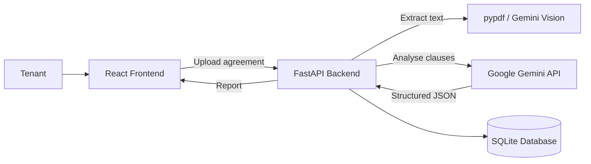

<div align="center">

# 🏠 RentWise

### Understand your rental agreement before you sign it.

AI-powered rental agreement reviewer that flags risky clauses, explains them in plain English, and drafts negotiation messages for tenants.


**[Live Demo](https://rentwise-one.vercel.app/)** · **[Report a Bug](../../issues)**

</div>

---

## 📖 About

Many tenants sign rental agreements without fully understanding them, which can lead to unfair deposits, long lock-in periods, unclear refund rules and harsh eviction terms.

**RentWise** lets you upload a PDF or a photo of your rental agreement and get:

- a **clause-by-clause review**, with each clause rated low, medium or high risk
- a **plain-English explanation** of what every clause means for you
- a list of **missing protections** (for example, no deposit refund timeline)
- **ready-to-send messages** asking your landlord to change risky clauses

> ⚠️ **Disclaimer:** RentWise provides guidance, not legal advice. For serious disputes, consult a qualified lawyer.

---

## 🎬 Demo


---

## ✨ Features

| Feature | Description |
|---|---|
| 📄 **Upload anything** | PDF agreements or photos of paper agreements |
| 🚦 **Risk rating** | Every clause is marked low, medium or high risk with an overall risk score |
| 💬 **Plain-English explanations** | The original clause appears beside a simple explanation |
| 🔍 **Missing protections** | Detects what the agreement should have but doesn't (notice period, deposit refund timeline, repair responsibility) |
| ✉️ **Negotiation drafts** | Polite, copy-ready messages for each risky clause |
| ✅ **Checklist** | Tick-off list of things to confirm before signing |
| 🕘 **History** | Saved reports, with the option to compare two agreements |

### Clause categories analysed

Security deposit · Rent increase · Notice period · Lock-in period · Maintenance and repairs · Eviction · Subletting · Utilities and other charges

---

## 🖼️ Pages

| Page | What it does |
|---|---|
| **Landing** | Explains the app, shows a sample report and an upload button |
| **Upload** | Drag-and-drop PDF or photo, plus city, monthly rent and deposit |
| **Report** | Colour-coded clauses, overall risk score, original text beside explanation |
| **Negotiation** | Generated message for each risky clause, with a copy button |
| **Checklist** | Missing protections and items to confirm |
| **History** | Past reports and a compare view |

---

## 🏗️ Architecture



**How it works**

1. The tenant uploads a PDF or photo.
2. The backend extracts the text (`pypdf` for PDFs, Gemini vision for photos).
3. Gemini analyses the text and returns **structured JSON**, which the backend validates with Pydantic.
4. The report is saved to the database and sent to the React frontend.

### Example AI output

```json
{
  "summary": "The agreement favours the landlord on deposit and lock-in terms.",
  "overall_risk": "medium",
  "clauses": [
    {
      "text": "The security deposit shall be refunded within a reasonable time...",
      "category": "deposit",
      "risk": "high",
      "explanation": "No fixed refund deadline is given, so the landlord can delay the refund.",
      "suggestion": "Ask for refund within 15 days of vacating."
    }
  ],
  "missing_protections": ["Deposit refund timeline", "Repair cost split"]
}
```

---

## 🧰 Tech Stack

| Layer | Technology |
|---|---|
| Frontend | React 18, Vite, Tailwind CSS, React Router |
| Backend | Python 3.11, FastAPI, Pydantic |
| Database | SQLite via SQLAlchemy (PostgreSQL-ready) |
| AI | Google Gemini API (`google-genai`), structured JSON output |
| Document parsing | `pypdf`, Gemini vision for photos |
| Deployment | Vercel (frontend), Render (backend) |

---

## 📁 Project Structure

```
rentwise/
├── backend/
│   ├── app/
│   │   ├── main.py          # FastAPI app and routes
│   │   ├── config.py        # environment settings
│   │   ├── gemini.py        # Gemini calls and prompts
│   │   ├── models.py        # database tables
│   │   ├── schemas.py       # Pydantic models
│   │   └── db.py
│   ├── tests/
│   ├── requirements.txt
│   └── .env.example
├── frontend/
│   ├── src/
│   │   ├── components/
│   │   ├── pages/           # Landing, Upload, Report, Negotiation, Checklist, History
│   │   └── api.js
│   ├── package.json
│   └── .env.example
└── README.md
```
---

## 🚀 Getting Started

### Prerequisites

- Python 3.11 or newer
- Node.js 20 or newer
- A free Gemini API key from [Google AI Studio](https://aistudio.google.com)

### 1. Clone the repository

```bash
git clone https://github.com/<your-username>/rentwise.git
cd rentwise
```

### 2. Run the backend

```bash
cd backend
python -m venv venv
source venv/bin/activate        # Windows: venv\Scripts\activate
pip install -r requirements.txt
cp .env.example .env            # Windows: copy .env.example .env
uvicorn app.main:app --reload
```

Add your values to `backend/.env`:

```env
GEMINI_API_KEY=your_key_here
GEMINI_MODEL=gemini-2.5-flash
DATABASE_URL=sqlite:///./rentwise.db
```

The API runs at `http://localhost:8000` and the interactive docs are at `http://localhost:8000/docs`.

### 3. Run the frontend

Open a second terminal:

```bash
cd frontend
npm install
cp .env.example .env
npm run dev
```

`frontend/.env`:

```env
VITE_API_URL=http://localhost:8000
```

Open `http://localhost:5173` in your browser.

> 🔐 Never commit `.env` files or put your API key in frontend code. Only the backend calls Gemini.
> Model names change over time, so check Google AI Studio for the current one.

---

## 🔌 API Reference

| Method | Endpoint | Description |
|---|---|---|
| `GET` | `/health` | Check the server is running |
| `POST` | `/agreements` | Upload an agreement (PDF or image) and get the analysis |
| `GET` | `/agreements` | List saved reports |
| `GET` | `/agreements/{id}` | Get one report with all clauses |
| `POST` | `/agreements/{id}/negotiation` | Generate negotiation messages for risky clauses |
| `DELETE` | `/agreements/{id}` | Delete a report and its uploaded file |

> Edit this table to match the endpoints your app actually has.

---

## 📊 Evaluation

I tested RentWise on sample agreements to check how reliable the analysis is.

| Metric | Result |
|---|---|
| Sample agreements tested | _N_ |
| Clause category accuracy | _X%_ |
| High-risk clauses correctly flagged | _X%_ |
| Missing protections correctly detected | _X%_ |
| Average analysis time | _X seconds_ |

**Method:** _Describe how you labelled the samples, for example "I manually labelled 120 clauses from 8 agreements and compared them to the model's output."_

Replace the placeholders with your real, measured numbers.

---

## 🔒 Privacy and Security

- API keys are kept in environment variables on the server only.
- Uploaded files are validated for type and size.
- Uploaded text is treated as untrusted, and the prompt tells the model to ignore any instructions found inside a document.
- Users can delete a report and its stored file at any time.
- Use sample or anonymised agreements for demos, and never commit real personal documents.

---

## ⚠️ Limitations

- Scanned photos with poor lighting or handwriting may extract badly.
- Risk ratings are AI-generated and may miss context or local rental rules.
- The app gives general guidance and doesn't know the laws of every state or country.
- Always read the original agreement and get professional advice for important decisions.

---

## 🗺️ Roadmap

- [ ] Region-specific rules (state-wise rent control and deposit limits)
- [ ] Side-by-side comparison of two agreements
- [ ] Export the report as a PDF
- [ ] Support for regional languages
- [ ] User accounts and saved agreements
- [ ] Mobile-friendly camera scanning

---

## ☁️ Deployment

- **Frontend:** deploy `frontend/` on Vercel and set `VITE_API_URL` to your backend URL.
- **Backend:** deploy `backend/` on Render as a web service with start command `uvicorn app.main:app --host 0.0.0.0 --port $PORT`, and add `GEMINI_API_KEY` in the environment settings.
- Allow CORS only for your frontend domain.

---

## 🤝 Contributing

Contributions are welcome. Fork the repo, create a branch (`git checkout -b feature/your-feature`), commit your changes, and open a pull request.

## 📄 License

Distributed under the MIT License. See `LICENSE` for details.

## 👤 Author

**Abi Nethra**
2nd-year B.Tech, Artificial Intelligence and Data Science
[GitHub](https://github.com/<your-username>) · [LinkedIn](https://linkedin.com/in/<your-profile>)

---

<div align="center">

If you found this useful, please give the repo a ⭐

</div>
